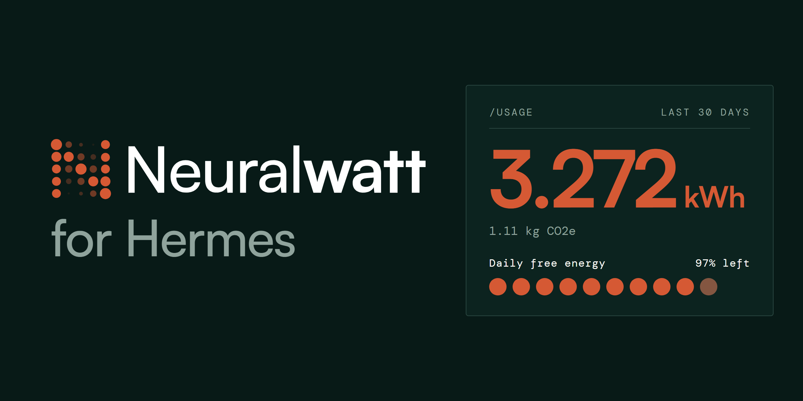

# Neuralwatt provider for Hermes



Run [Hermes](https://github.com/NousResearch/hermes-agent) on [Neuralwatt](https://neuralwatt.com). You get the live model list, reasoning effort that works, and your balance and energy use in `/usage`.

## Install

```bash
hermes plugins install ptaranat/hermes-neuralwatt-provider
```

Add your key from the [Neuralwatt Portal](https://portal.neuralwatt.com) to `~/.hermes/.env`:

```bash
NEURALWATT_API_KEY=sk-...
```

Then pick Neuralwatt in `hermes model`. Or set it in `~/.hermes/config.yaml`:

```yaml
model:
  provider: neuralwatt
  default: nw-large
```

`NEURALWATT_BASE_URL` changes the API URL. The default is `https://api.neuralwatt.com/v1`.

### Coming from Neuralwatt's recipe

Neuralwatt's [Hermes recipe](https://github.com/neuralwatt/neuralwatt-tools/tree/main/recipes/hermes) uses the same provider name and env vars. Your config keeps working. Remove the recipe first so both don't register `neuralwatt`:

```bash
rm -r ~/.hermes/plugins/model-providers/neuralwatt
```

## What you get

- **Models.** `/model` lists Neuralwatt's live catalog with real context windows. If the catalog is down, you still get `nw-large`, `nw-flash` and `nw-small`. Side tasks like compression use `nw-flash`.
- **Reasoning effort.** Your Hermes reasoning setting is sent as `reasoning_effort`. The recipe never sends it. Without it, requests run at the model's default (often `max`). Turning reasoning off sends `none`. GLM 5.3 can't turn it off. It gets its lightest level instead.
- **Sessions.** Each Hermes session is sent as a conversation id. The Neuralwatt dashboard then shows one session per conversation.
- **Cost per turn.** Energy-billed accounts get an energy estimate. It uses Neuralwatt's published average energy per request for that model and prompt size, at your $/kWh rate. Like Neuralwatt's own billing, it never goes above the token price. Turns covered by daily free energy or a plan's kWh allowance show as included. Token-billed accounts get an estimate from token prices. These are estimates. `/usage` has the exact spend.
- **`/usage`.** Credits left, this month's spend and energy, daily free energy, plan or key limits, and 30-day energy and carbon.

For Neuralwatt tools the agent can call (usage, requests, sessions), install [0xGingi's neuralwatt plugin](https://github.com/0xGingi/neuralwatt-hermes) too.

## Privacy

- It only talks to Neuralwatt: the API, and the public energy price table at `portal.neuralwatt.com`.
- The conversation id is Hermes's session id. It has no prompt text. Neuralwatt stores a hash of it.
- Your key is read through Hermes's secret scope.
- It writes no files and starts no threads or processes.

## Compatibility

Hermes 0.22.6 or newer.

## Development

```bash
python -m unittest discover -s tests -v
```

The tests use saved API responses. They don't need a key or Hermes.

## License

MIT. Not affiliated with Neuralwatt. The Neuralwatt name and logo belong to Neuralwatt.
